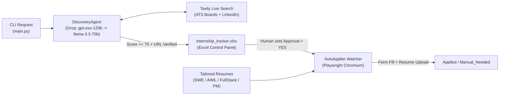

# Auto Job Application Pipeline

An agentic internship discovery, tiered referral-research, and **human-in-the-loop** browser auto-application pipeline powered by **Groq**, **Tavily**, **OpenPyXL**, and **Playwright**.

Built to automate high-signal internship hunting across **Software Engineering (Backend/Systems)**, **AI/ML & Agentic Systems**, **Full-Stack Web**, and **Product Management (APM)** roles—without hallucinated links, blind form submissions, or automated cold-outreach spam.

---

## Key Capabilities

- **Dual-Model Groq Failover**: Uses `openai/gpt-oss-120b` as the primary tool-calling reasoning model and automatically switches to `llama-3.3-70b-versatile` on rate limits or transient API errors (with exponential backoff and `Retry-After` support).
- **Zero-Hallucination Web Discovery & Strict India-Only Gate**: Searches live ATS boards (`boards.greenhouse.io`, `jobs.lever.co`, `jobs.ashbyhq.com`, and company career portals) via Tavily, enforces strict URL provenance (`seen_urls` verification), and **verifies both the claimed location and live ATS posting location markup** so only internships in **India** (e.g., Bengaluru, Hyderabad, Pune, Mumbai, Gurugram, Noida, Chennai, or `Remote - India`) are accepted—automatically rejecting non-Indian postings (such as US, Canada, or Europe).
- **3-Tier Referral Contact Cascade**: Discovers up to two verified LinkedIn contacts (`Primary` + `Backup`) currently working at each matched company:
  1. **Tier 1 — Alumni**: Thapar Institute of Engineering & Technology alumni in engineering roles at the target company.
  2. **Tier 2 — SWE**: Mid-level Software Engineers (`SDE-1` / `SDE-2`) aligned with the role's tech stack.
  3. **Tier 3 — Recruiter**: University, Campus, or Technical Recruiters at the company.
  - *Automatic Role Filtering*: Rejects C-suite/founders/VPs, current interns/trainees, and former (`ex-`) employees. Never drafts or sends automated messages.
- **Role-Aware Multi-Resume Routing**: Automatically classifies each internship into one of four tailored resume tracks (`swe`, `aiml`, `fullstack`, `pm`) and uploads the matching resume file during application—overridable directly from Excel.
- **Excel Human-in-the-Loop Control Plane**: Generates a formatted `internship_tracker.xlsx` workbook with dropdown data validation (`Pending` / `YES` / `NO` and `swe` / `aiml` / `fullstack` / `pm`), conditional color formatting, MD5 `Company + Role` deduplication, and automatic retry handling while the sheet is open in Microsoft Excel.
- **Playwright Assisted Auto-Applier**: Watches Excel for `Approval = YES`, opens a visible Chromium browser, maps candidate profile fields to form inputs, uploads the selected resume, pauses for visual verification, and holds the browser open if custom questions or human verification steps remain.

---

## Architecture & Workflow



---

## Tailored Multi-Resume Routing & Candidate Context

The pipeline scores roles (`0–100`, saving matches `>= 75`) against the candidate profile configured in `files/config.py` and routes each job to a role-specific resume inside `files/resumes/`:

| Track Key | Default Resume File | Target Roles | Core Highlighted Stack & Focus |
| :--- | :--- | :--- | :--- |
| `swe` | `Saket_Bhadada_SWE.pdf` | Backend, Distributed Systems, Core SWE Intern | Python, C/C++, JavaScript (ES6+), SQL, FastAPI, Node.js/Express, PostgreSQL (`pgvector`), REST APIs, WebSockets, DSA, Testing |
| `aiml` | `Saket_Bhadada_AIML.pdf` | AI/ML, LLM, Agentic AI, RAG, Deep Learning Intern | PyTorch (LSTM/RNN), LangGraph, RAG, LLM Orchestration, Vector Search (`pgvector` HNSW), FastAPI |
| `fullstack` | `Saket_Bhadada_FullStack.pdf` | Frontend, React, Full-Stack Web Engineer Intern | React, Vite, HTML5/CSS3, Node.js, Express.js, PostgreSQL, WebSockets, Low-Latency UI Architecture |
| `pm` | `Saket_Bhadada_PM.docx` | Product Management (APM), Product Strategy Intern | Feature Scoping, Phased Roadmapping, Technical Trade-off Analysis, Campaign Outreach, Full-Stack + ML Literacy |

### Profile Context Used by the Discovery Agent

- **Education**: B.Tech in Computer Science & Business Systems — *Thapar Institute of Engineering & Technology* (2024 – 2028)
- **Experience Highlights**:
  - *Frontend Intern @ Motion Education Pvt. Ltd.* — Modular React UI components & async REST API integration serving 5,000+ active learners.
  - *Media Head @ Thapar Mathematical Club* — Technical outreach driving 100+ workshop attendees and 250+ competition participants.
- **Featured Engineering Projects**:
  - **Super Docs**: Agentic document extraction & auditing pipeline (`FastAPI`, `LangGraph`, `React`, `PostgreSQL/pgvector`, `RAG`) with deterministic human-in-the-loop approval gates.
  - **Arc-Stream**: AI DJ & energy-curve playlist engine (`PyTorch LSTM`, `FastAPI`, `Node.js`, `pgvector` HNSW across 114,000+ tracks, Spotify API).
  - **TEDxTIET Platform**: Production event & ticketing web ecosystem (`React`, `Node.js`, `Express`, `PostgreSQL`) sustaining 99.9% uptime for 1,000+ daily visitors.
  - **Cascade**: Supply chain capacity & anomaly monitoring (`RNN` sequence modeling, `FastAPI`, `React`, `PostgreSQL`).
  - **Project Pulse**: Real-time student–faculty collaboration platform (`React`, `Node.js`, `PostgreSQL`, `WebSockets`) with `<0.5s` indexed query latency.

*(Note: Sensitive fields such as `email`, `phone`, and local `resume_path` are stripped before constructing LLM prompts and are only read locally by Playwright when filling application forms.)*

---

## Repository Structure

```text
auto-job-applycation/
├── files/
│   ├── main.py               # CLI entry point (--discover, --watch, --all)
│   ├── config.py             # Env loader, Groq models, multi-resume router & validation
│   ├── agent_discovery.py    # Groq tool-calling discovery & 3-tier referral agent
│   ├── excel_manager.py      # Thread-safe OpenPyXL tracker with dropdowns & lock retries
│   ├── auto_applier.py       # Excel watcher + Playwright Chromium form filler
│   ├── requirements.txt      # Python dependencies
│   ├── _.env.example         # Safe template for environment configuration
│   ├── .env                  # Local secrets & candidate details (gitignored)
│   ├── resumes/              # Tailored PDF/DOCX resumes by track (gitignored)
│   └── internship_tracker.xlsx # Generated at runtime (gitignored)
├── .gitignore
├── .gitattributes
└── README.md
```

---

## How to Start & Run This Project

### Prerequisites

- **Python 3.10+** installed and added to `PATH` (`python --version`)
- **Groq API Key** — free key from [console.groq.com](https://console.groq.com)
- **Tavily API Key** — free key from [tavily.com](https://tavily.com)
- **Spreadsheet Editor** — Microsoft Excel or LibreOffice Calc (to review jobs and set `Approval = YES / NO`)

---

### One-Time Setup (First Run)

#### Step 1 — Open Terminal in the Project Folder

```powershell
git clone https://github.com/saket-bhadada/auto-job-applycation.git
cd auto-job-applycation
```

#### Step 2 — Create & Activate a Virtual Environment

**Windows (PowerShell):**
```powershell
python -m venv .venv
# If PowerShell blocks script execution, run this once for the current session:
Set-ExecutionPolicy -Scope Process -ExecutionPolicy Bypass
.\.venv\Scripts\Activate.ps1
```

**Windows (Command Prompt / `cmd.exe`):**
```cmd
python -m venv .venv
.venv\Scripts\activate.bat
```

**macOS / Linux:**
```bash
python3 -m venv .venv
source .venv/bin/activate
```

#### Step 3 — Install Dependencies & Playwright Browser

```powershell
pip install -r files/requirements.txt
playwright install chromium
```

#### Step 4 — Configure `files/.env` & Resumes

1. Create `files/.env` from the template:
   ```powershell
   Copy-Item files\_.env.example files\.env
   ```
2. Open `files/.env` and fill in your `GROQ_API_KEY`, `TAVILY_API_KEY`, and candidate profile fields.
3. Place your tailored resume(s) inside `files/resumes/` matching the paths configured in `files/.env` (if you only provide `RESUME_PATH`, every track automatically falls back to that single resume).

---

### Starting the Project (Daily Workflow)

Whenever you open a new terminal in `auto-job-applycation`, activate `.venv` (or invoke `.\.venv\Scripts\python.exe` directly) and choose one of the three modes below:

#### Mode 1: Full End-to-End Pipeline (`--all`) — *Recommended*

Discovers internships, saves verified matches + referral contacts into `files/internship_tracker.xlsx`, and immediately starts the Excel watcher:

```powershell
# Run with the default Summer 2027 Backend / AI query:
python files/main.py --all

# Or pass your own discovery prompt:
python files/main.py --all "Find 5 Summer 2027 Backend or AI Internships in India"
```

#### Mode 2: Discover First (`--discover`), Apply Later (`--watch`)

**1. Run AI Discovery for a specific role track (India-only enforced automatically):**
```powershell
# Backend / SWE Internships (India)
python files/main.py --discover "Find 5 Summer 2027 Backend or SWE Internships in India"

# AI / ML / Agentic Engineering Internships (India)
python files/main.py --discover "Find 5 AI, LLM, or Machine Learning Internships in India"

# Full-Stack / React Internships (India)
python files/main.py --discover "Find 5 Full-Stack or React Frontend Internships in India"

# Product Management / APM Internships (India)
python files/main.py --discover "Find 5 Associate Product Manager or Product Internships in India"
```

**2. Review & Approve in Excel (`files/internship_tracker.xlsx`):**
- Check `Company`, `Role`, `Job_URL`, `Match_Score`, and the discovered `Primary_Referral` / `Backup_Referral` LinkedIn contacts.
- Verify or switch `Resume_Track` (`swe`, `aiml`, `fullstack`, `pm`) using the cell dropdown.
- Change `Approval` from `Pending` to **`YES`** (to auto-apply) or **`NO`** (to skip).
- **Save (`Ctrl + S`) and close Excel** so the watcher can update `Apply_Status` without Windows file locks.

**3. Start the Auto-Applier Watcher (`--watch`):**
```powershell
python files/main.py --watch
```
- Every `10s`, the watcher checks `files/internship_tracker.xlsx`.
- For each row with `Approval = YES` and `Apply_Status = Waiting`, Playwright launches a visible **Chromium** window, fills out your profile details, uploads the track-matched resume, pauses `VERIFY_SECONDS` (`15s`) for visual review, and keeps the browser open up to `MANUAL_HOLD_SECONDS` (`120s`) so you can answer custom questions or click **Submit** (when `AUTO_SUBMIT=false`).
- Press **`Ctrl + C`** in the terminal at any time to stop the watcher cleanly.

#### Running Directly Without Activating `.venv` (Windows Shortcut)

```powershell
.\.venv\Scripts\python.exe files\main.py --discover "Find 5 Summer 2027 Backend or AI Internships in India"
.\.venv\Scripts\python.exe files\main.py --watch
```

---

### Troubleshooting

| Issue | Fix |
| :--- | :--- |
| `Activate.ps1 cannot be loaded because running scripts is disabled` | Run `Set-ExecutionPolicy -Scope Process -ExecutionPolicy Bypass` first, or use `.\.venv\Scripts\python.exe` directly. |
| `'internship_tracker.xlsx' is open in Excel - close it` | Windows locks `.xlsx` files while open in Excel. Save (`Ctrl + S`) and close Excel so the script can write updates. |
| `Executable doesn't exist` (Playwright error) | Run `.\.venv\Scripts\playwright.exe install chromium` to download the Chromium browser binary. |
| `Config: GROQ_API_KEY missing in .env` | Ensure your file is named `.env` inside the `files/` directory (`files/.env`), not `_.env.example`. |

---

## Environment Variables (`files/.env`)

| Variable | Default / Example | Description |
| :--- | :--- | :--- |
| `GROQ_API_KEY` | *(Required for `--discover`)* | Groq API key for `openai/gpt-oss-120b` & `llama-3.3-70b-versatile` |
| `TAVILY_API_KEY` | *(Required for `--discover`)* | Tavily API key for live web & ATS searches |
| `CANDIDATE_NAME` | `Saket Bhadada` | Full name split into first/last name for application forms |
| `CANDIDATE_EMAIL` | `you@example.com` | Email address filled into application forms |
| `CANDIDATE_PHONE` | `+91XXXXXXXXXX` | Contact phone number for application forms |
| `CANDIDATE_GRAD_YEAR` | `2028` | Expected graduation year |
| `CANDIDATE_CGPA` | `7.41` | Current cumulative GPA |
| `CANDIDATE_SKILLS` | `Python, FastAPI, React...` | Comma-separated skills used for LLM fit scoring |
| `CANDIDATE_LINKEDIN` | `https://www.linkedin.com/in/...` | LinkedIn profile URL |
| `CANDIDATE_GITHUB` | `https://github.com/...` | GitHub profile URL |
| `CANDIDATE_PORTFOLIO` | *(Optional)* | Personal website / portfolio URL |
| `RESUME_PATH` | `resumes/Saket_Bhadada_SWE.pdf` | Default fallback resume path |
| `RESUME_SWE_PATH` | `resumes/Saket_Bhadada_SWE.pdf` | Resume uploaded for `swe` track roles |
| `RESUME_AIML_PATH` | `resumes/Saket_Bhadada_AIML.pdf` | Resume uploaded for `aiml` track roles |
| `RESUME_FULLSTACK_PATH` | `resumes/Saket_Bhadada_FullStack.pdf` | Resume uploaded for `fullstack` track roles |
| `RESUME_PM_PATH` | `resumes/Saket_Bhadada_PM.docx` | Resume uploaded for `pm` track roles |
| `INDIA_ONLY` | `true` | Enforce strict India-only location validation (both LLM claim + live ATS page check) |
| `AUTO_SUBMIT` | `false` | `true` clicks Submit when all required fields & resume are ready; `false` fills only |
| `VERIFY_SECONDS` | `15` | Pause duration (seconds) for visual review before submission |
| `MANUAL_HOLD_SECONDS` | `120` | Time window browser stays open for custom fields or human verification |

---

## Excel Tracker Schema (`internship_tracker.xlsx`)

| Column | Purpose |
| :--- | :--- |
| `Job_ID` | 12-char MD5 hash of normalized `Company + Role` (prevents duplicates) |
| `Company` / `Role` | Verified company name and exact internship title |
| `Location` | Verified Indian city/state or `Remote - India` |
| `Job_URL` | Direct application URL verified against Tavily search results |
| `Match_Score` | LLM fit score (`75–100`) |
| `Resume_Track` | Dropdown (`swe`, `aiml`, `fullstack`, `pm`) selecting which resume to upload |
| `Primary_Referral` / `Primary_LinkedIn` | Best-tier current employee contact & verified LinkedIn URL |
| `Referral_Tier` | Tier summary (`Tier 1 - Alumni`, `Tier 2 - SWE`, `Tier 3 - Recruiter`) |
| `Backup_Referral` / `Backup_LinkedIn` | Second distinct contact & verified LinkedIn URL |
| `Approval` | Human gate dropdown: `Pending`, `YES` (green), `NO` (red) |
| `Apply_Status` | Lifecycle state: `Waiting` → `In_Progress` → `Applied` / `Manual_Needed` / `Skipped` |
| `Last_Updated` | Timestamp of last agent or watcher update |

---

## Safety & Privacy Guardrails

1. **No Cold-Outreach Automation**: The discovery agent only identifies public referral contacts; it is strictly forbidden from drafting or sending emails or LinkedIn messages.
2. **Human Approval Gate**: No browser session opens for any job until `Approval` is explicitly set to `YES` in Excel.
3. **Human Verification Respect**: The applier never attempts to bypass anti-bot challenges or CAPTCHAs; instead, it keeps the visible Chromium window open (`MANUAL_HOLD_SECONDS`) so you can complete custom questions or verification manually.
4. **Git Hygiene**: `.env`, `files/resumes/`, `*.pdf`, `*.docx`, and `*.xlsx` are excluded via `.gitignore` so personal resumes, spreadsheets, and API keys stay local.

---

## Author

**Saket Bhadada**  
B.Tech in Computer Science & Business Systems — *Thapar Institute of Engineering & Technology*  
[GitHub](https://github.com/saket-bhadada) · [LinkedIn](https://www.linkedin.com/in/saket-bhadada-11aa22331/) · [Email](mailto:saketbhadada@gmail.com)
